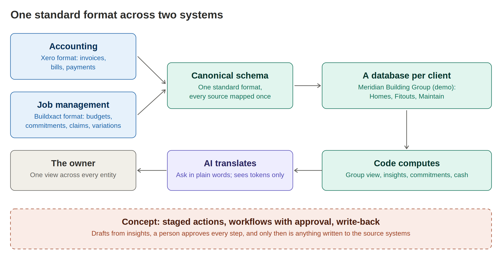
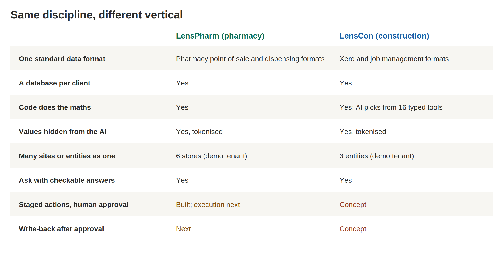
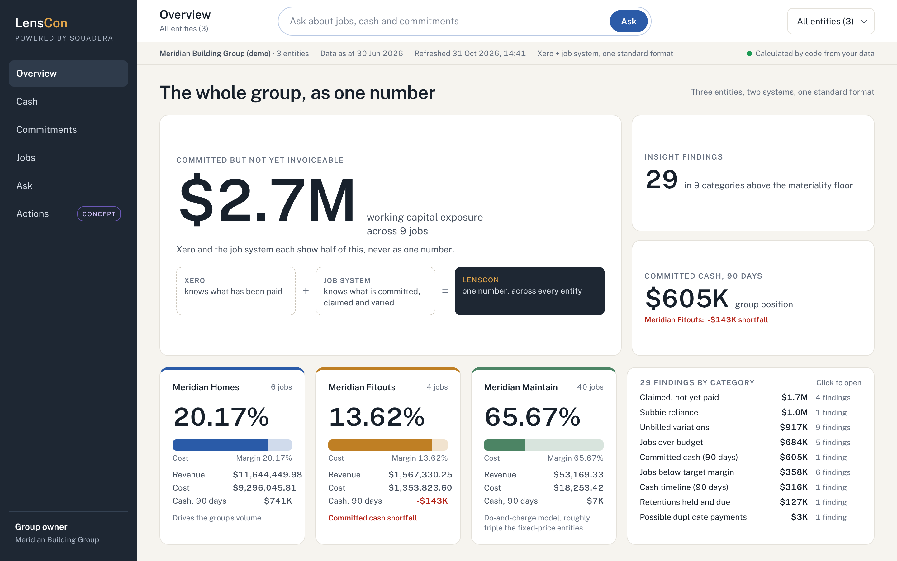
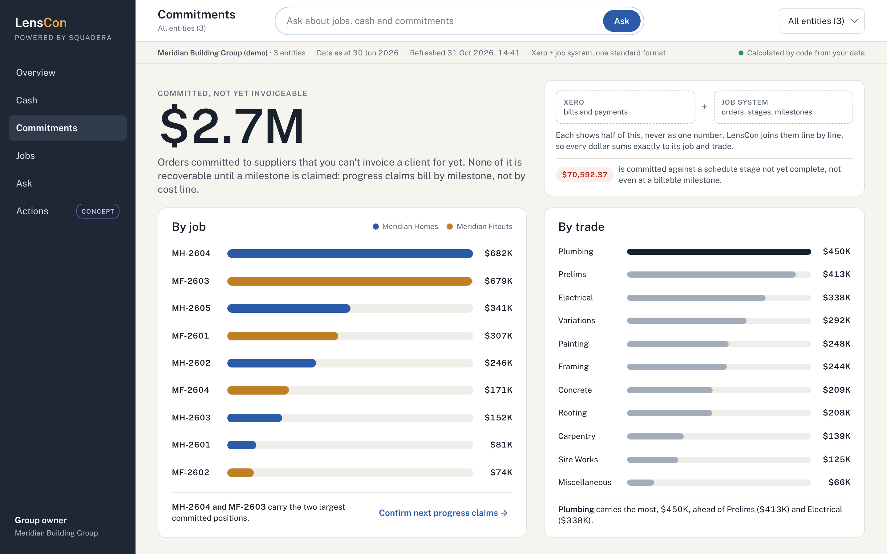
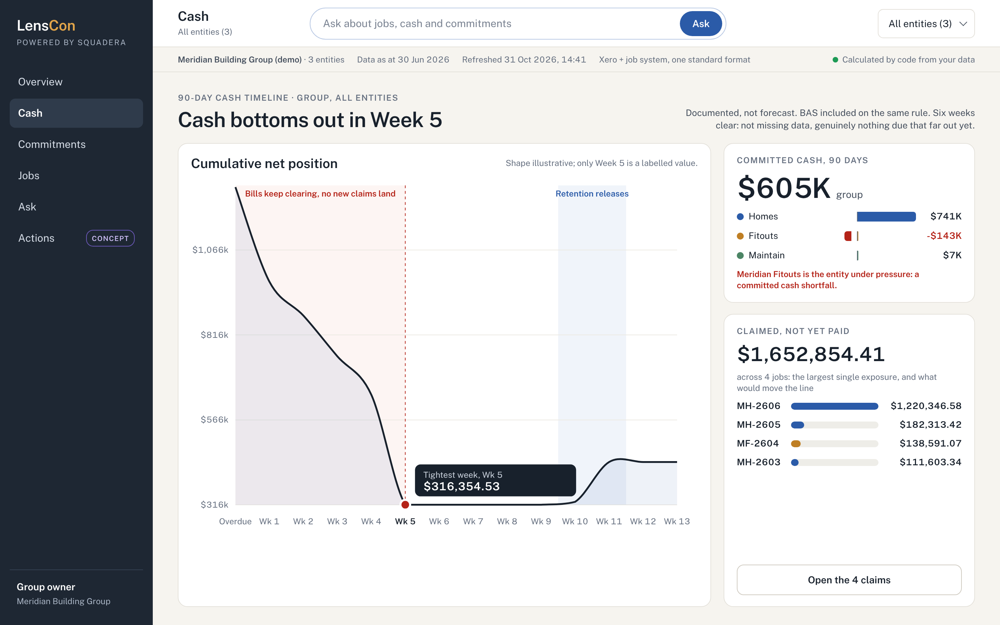
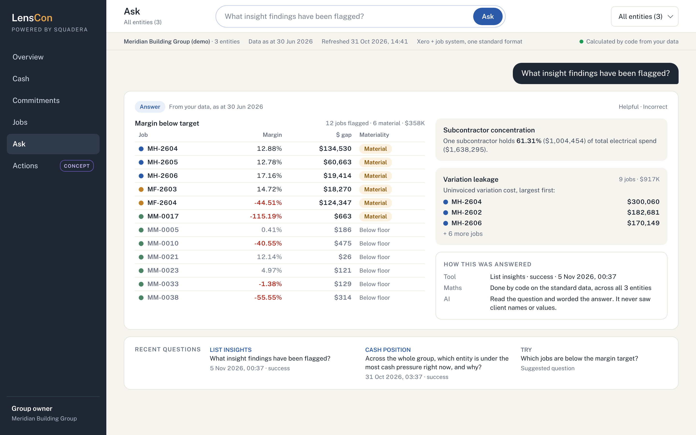
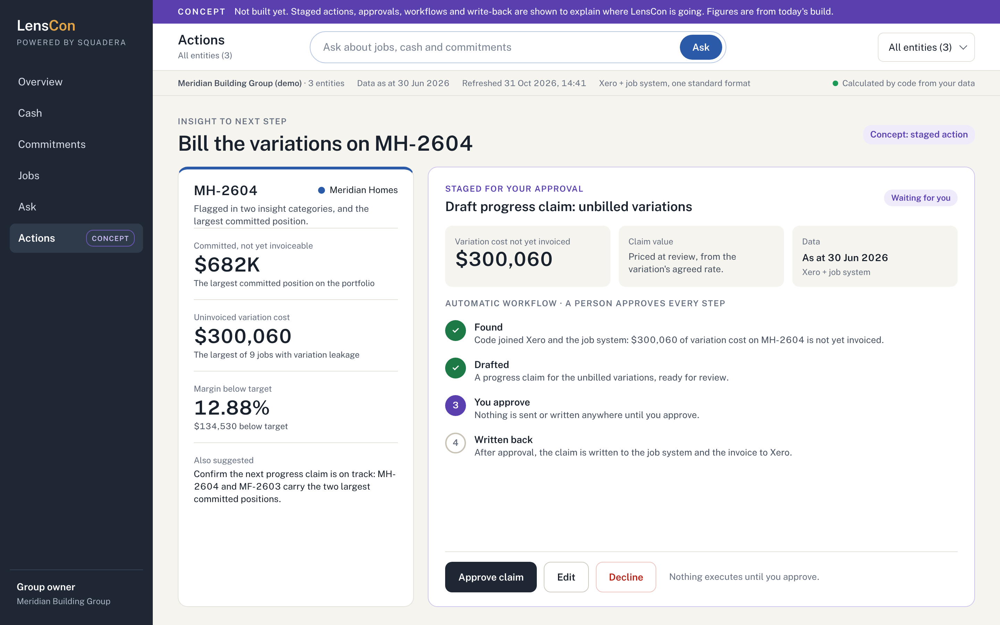

# LensCon

**One view of a construction group, across its accounting and its jobs.**

LensCon is the second vertical of [Squadera](https://squadera.io/lenscon), applying the same approach as [LensPharm](https://github.com/sonny-stack/lenspharm-case-study) to multi-entity building groups.

Built by **Sonny Trikha**, Product Lead and Co-Founder, Squadera. [LinkedIn](https://linkedin.com/in/sonnytrikha)

> **Status: in development.** A working prototype that runs locally on synthetic demo data (Meridian Building Group, three entities). It is not deployed and has no live connections yet. Images are product designs using figures from that demo data; concept frames are labelled as such.

---

## The problem

A building group's truth is split across two systems. Accounting knows what has been paid. The job management system knows what has been committed, claimed and varied. Neither sees the whole, and with several entities in the group, nobody has one number for where the money actually is.

The prototype's own line puts it simply: Xero and the job system each show half of this, never as one number.

## The approach

LensCon is built on the same engine design as LensPharm: one standard data format, a database per client, code doing every calculation, and an AI that translates the question and words the answer without ever seeing client names or values.

Accounting data in Xero format and job data in Buildxact format are each mapped once into a canonical schema, the single standard shape every insight is computed from. That is what makes a consolidated, group-level view possible, and why a new source system means a new mapping rather than a new product.

## What it does today

On the demo group of three entities:

- **Group view.** Margin, revenue, cost and committed cash for every entity side by side, with shortfalls called out.
- **Insights.** Nine categories, including committed spend not yet invoiceable, claims not yet paid, unbilled variations, jobs below target margin, reliance on a single subcontractor, retentions held and due, and possible duplicate payments.
- **Cash.** A 90-day timeline built only from documented items, showing the tightest week before it arrives.
- **Ask.** Plain-language questions answered by picking from 16 typed, pre-written tools. The AI never writes its own query, so every figure comes from tested code.

## Where it goes next

- **Staged actions** from insights, for example drafting a progress claim for unbilled variations
- **Automatic workflows** with a person approving every step
- **Write-back** to the source systems, only after approval
- **Live connections** to accounting and job management software, replacing synthetic data

The concept frame shows where this goes: an insight becomes a drafted action, a person approves every step, and only then is anything written back to Xero or the job system. It is not built yet.

## What carried across verticals

Building a second vertical was the real test of the approach. What carried across cleanly was the discipline rather than the code: the same rules applied to new data, new vocabulary and new risks. The same classes of problem also showed up in both, so I now check for them from the first day of a new vertical instead of finding them later.

## How it's built

- Python, React and DuckDB, with a separate database per client
- Claude through the Anthropic SDK, choosing from a registry of 16 typed tools
- Client values tokenised before any model call, tested across every tool

---

*Squadera Pty Ltd, Sydney. [squadera.io](https://squadera.io)*
