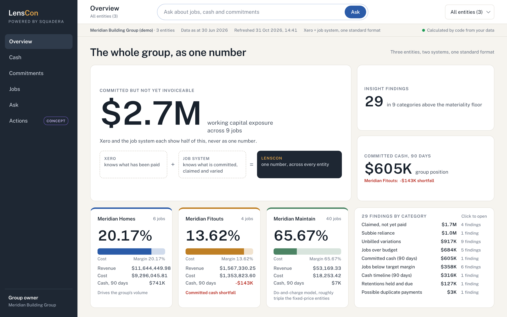
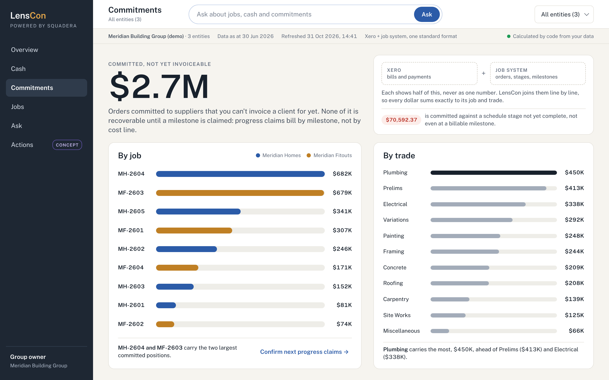
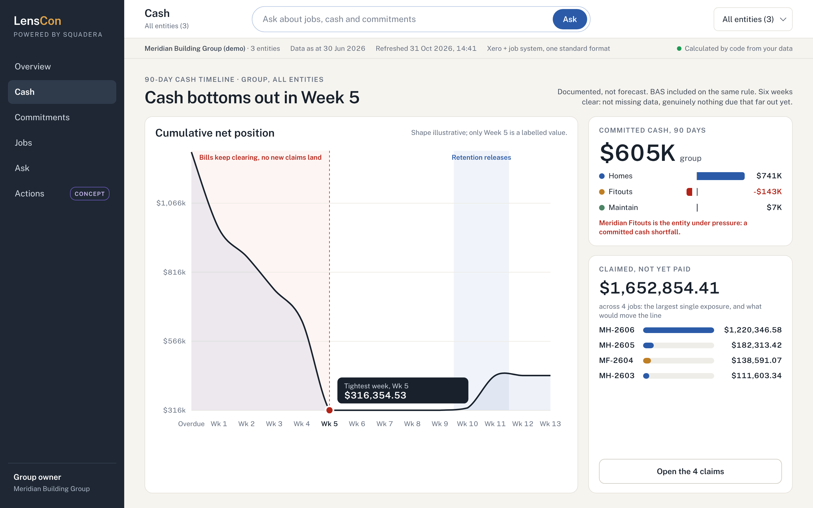
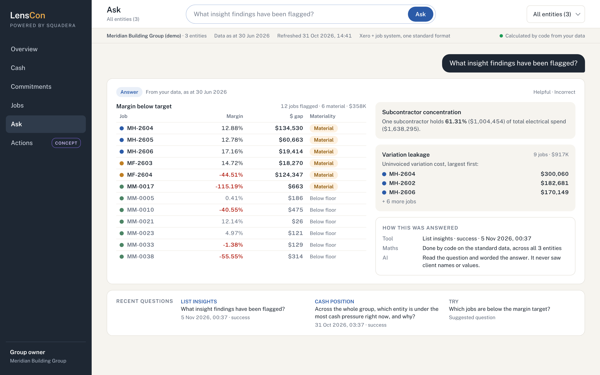
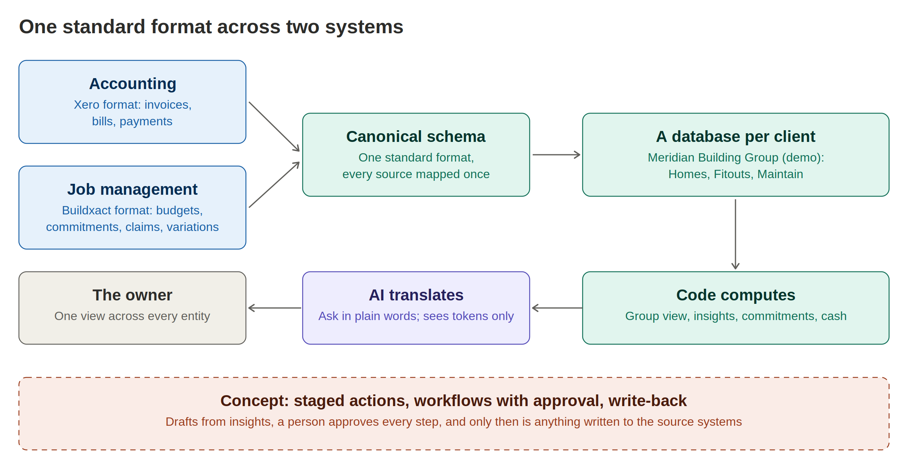
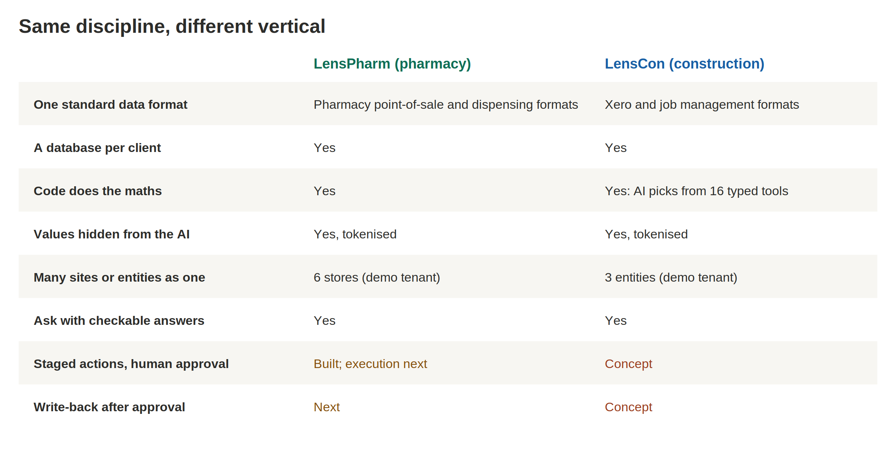
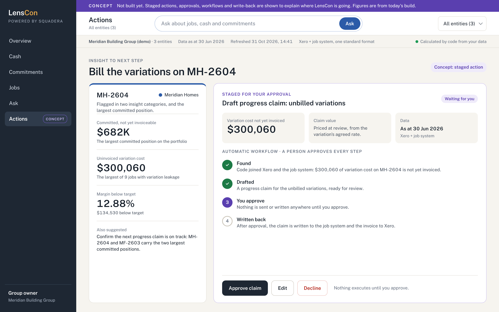

# LensCon

**One view of a construction group, across its accounting and its jobs.**

LensCon is the second vertical of [Squadera](https://squadera.io/lenscon), applying the same approach as [LensPharm](https://github.com/sonny-stack/lenspharm-case-study) to multi-entity building groups.

Built by **Sonny Trikha**, Product Lead and Co-Founder, Squadera. [LinkedIn](https://linkedin.com/in/sonnytrikha)

> **Status: in development.** A working prototype that runs locally on synthetic demo data (Meridian Building Group, three entities). It is not deployed and has no live connections yet. Images are product designs using figures from that demo data; concept frames are labelled as such.

**On this page:** [The problem](#1-the-problem) · [The product](#2-the-product) · [The architecture](#3-the-architecture) · [The evidence](#4-the-evidence) · [The decisions](#5-the-decisions)

---

## 1. The problem

A building group's truth is split across two systems. Accounting knows what has been paid. The job management system knows what has been committed, claimed and varied. Neither sees the whole, and with several entities in the group, nobody has one number for where the money actually is.

The prototype's own line puts it simply: Xero and the job system each show half of this, never as one number.

## 2. The product

On the demo group of three entities:

- **Group view.** Margin, revenue, cost and committed cash for every entity side by side, with shortfalls called out.
- **Insights.** Nine categories, including committed spend not yet invoiceable, claims not yet paid, unbilled variations, jobs below target margin, reliance on a single subcontractor, retentions held and due, and possible duplicate payments.
- **Cash.** A 90-day timeline built only from documents already issued, showing the tightest week before it arrives.
- **Ask.** Plain-language questions answered by picking from 16 typed, pre-written tools.

## 3. The architecture

Accounting data in Xero format and job data in Buildxact format are each mapped once into a canonical schema, the single standard shape every insight is computed from. A new source system means a new mapping, not a new product.

**Three doors, one set of tested queries.** The same 16 query functions sit behind:

| Door | Who uses it | What the AI sees |
|---|---|---|
| Dashboard | People, in the browser | No AI involved |
| Ask | An owner asking in plain words | Placeholders only, never client names or values |
| MCP server | Claude Desktop or Claude Code, connected locally | The tools, under the operator's own session |

Every call through every door is logged and tagged with the route it came through. The 16 tools cover findings, jobs, costs and suppliers, money owed and cash (including a separately labelled payroll estimate), and data freshness.

**Stack:** Python, React and a separate DuckDB database per client. Claude through the Anthropic SDK for Ask, and the MCP Python SDK for the MCP server. The Xero connection is designed but not switched on; the demo runs on Xero-shaped synthetic data.

## 4. The evidence

| What is checked | How |
|---|---|
| The insights find what they should | The synthetic data has findings planted in it on purpose. A ground-truth test checks the engine finds every one: 13 of 13. |
| One number, wherever it appears | A consistency test checks every query figure equals the insight engine's figure to the cent, across all nine categories. Both read the same single computation. |
| The AI never sees client values | A coverage test calls every one of the 16 tools with real data and confirms each result is fully converted to placeholders. |
| No AI-written queries | Every query is hand-written and parameterised in one place. No tool accepts or runs SQL from the AI. |
| Read-only by design | Every connection to client data opens read-only. |
| Known gaps are written down | For example, the company filter accepts free text, so an unknown name falls back to the whole group. It is logged, with the fix: a fixed list of companies, like every other input. |

## 5. The decisions

| Decision | Why | What it cost |
|---|---|---|
| Tools only, never AI-written queries | Every answer comes from code that can be tested | 16 question shapes, not unlimited ones |
| Client values hidden from the AI | Construction finance data is commercially sensitive | Extra work to put the real figures back |
| "Committed" kept apart from "estimated" | Finance teams need to know which is which | Payroll shown as a separate, labelled estimate |
| One standard format for all sources | A new system is a mapping, not a rebuild | Up-front schema design before any feature |
| An MCP server over the same tools | Any AI assistant gets the same governed answers | Hosting and per-user sign-in still to build |

## Where it goes next

- **Staged actions** from insights, for example drafting a progress claim for unbilled variations
- **Automatic workflows** with a person approving every step
- **Write-back** to the source systems, only after approval
- **Live connections** to accounting and job management software, replacing synthetic data

The concept frame shows where this goes: an insight becomes a drafted action, a person approves every step, and only then is anything written back to Xero or the job system. It is not built yet.

## What carried across verticals

Building a second vertical was the real test of the approach. What carried across cleanly was the discipline rather than the code: the same rules applied to new data, new vocabulary and new risks. The same classes of problem also showed up in both, so I now check for them from the first day of a new vertical instead of finding them later.

---

*Squadera Pty Ltd, Sydney. [squadera.io](https://squadera.io)*
